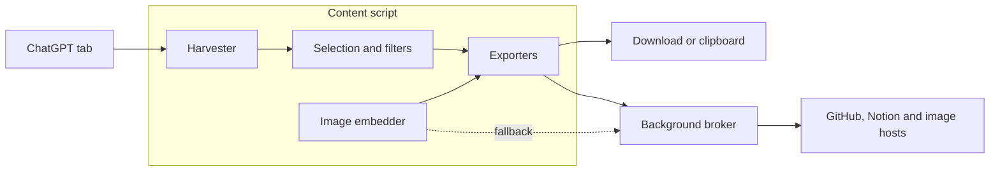

<div align="center">


# Capsula

**Save your ChatGPT conversations as files you own.**

A browser extension for Firefox, Chrome and Edge that exports ChatGPT chats to Markdown, HTML,<br>
JSON or a statistics dashboard, or sends them to a GitHub Gist or a Notion page.

[](https://addons.mozilla.org/firefox/addon/capsula/)
[](https://chromewebstore.google.com/detail/capsula/bmhecmkffkebeajfplkngnjookpefmoe)
[](LICENSE)

[**Install for Firefox**](https://addons.mozilla.org/firefox/addon/capsula/) ·
[**Install for Chrome or Edge**](https://chromewebstore.google.com/detail/capsula/bmhecmkffkebeajfplkngnjookpefmoe) ·
[Website](https://seveneves.ai/capsula) ·
[Privacy](PRIVACY.md) ·
[Report a bug](https://github.com/sevenevesai/capsula/issues/new)

</div>

---

A long ChatGPT conversation is hard to keep. Copy and paste flattens code blocks, tables and
math, image links stop working after a while, and the page only loads the messages near where
you have scrolled.

Capsula adds an export button to ChatGPT. Pick the messages you want, check the preview, then
download or copy them in the format you need, or send them to GitHub or Notion. It reads the
conversation open in your tab, inside your browser: there are no Capsula servers, accounts or
analytics. It does not back up or sync your history.

## Features

### Export formats

| Format | What you get |
|---|---|
| Markdown (`.md`) | Headings, nested lists, pipe tables, fenced code with its language, LaTeX math, and images embedded as data URIs. Optional prefix and suffix text from Settings. |
| HTML (`.html`) | A standalone page with light and dark styles, math rendered as MathML, and a Content Security Policy that blocks scripts. |
| JSON (`.json`) | The structured conversation: metadata, each message as typed blocks, and the filters used. Shape below. |
| Dashboard (`.html`) | Statistics on one page: message and content counts, code languages, thinking time, canvas documents and attachments, with bar charts. Opened from the bar-chart button in the panel header. |

**Export Conversation** downloads `<title>_<YYYY-MM-DD_HH-MM-SS>.<ext>` and **Copy to
Clipboard** copies the same export. The format picker remembers your last choice. Right-click
any assistant message to copy just that answer or export it as Markdown, HTML or JSON.

The JSON export, for scripts and agents that process it:

```jsonc
{
  "meta": { "title": "…", "url": "…", "model": "…", "exported_at": "<ISO 8601>", "exportVersion": "<version>" },
  "messages": [
    {
      "index": 0,
      "role": "user",              // or "assistant"
      "timestamp": "<ISO 8601>",   // when ChatGPT provides it
      "model": "…",
      "blocks": [{ "kind": "para", "md": "…" }]
      // block kinds: para, heading, list, table, code, math, quote, divider, image, writing
    }
  ],
  "exportSettings": { "filters": { … }, "range": … , "ui": { … } }
}
```

### Choose what goes in

- **Timeline.** Drag on the timeline beside the preview to select a range, then adjust it with
  its handles. Ctrl+Click toggles a message, Shift+Click extends the selection, Ctrl+Drag adds
  or removes several, and right-click clears it.
- **Message toggles.** Each message in the preview has a toggle. Excluded messages turn grey and
  collapse, and stay in sync with the timeline.
- **Filters.** **Assistant Only** drops your messages. **Code**, **Tables** and **Lists** keep
  only those blocks, and combine with each other.

### Keep what was in the chat

- **The whole thread.** Capsula reads the conversation from ChatGPT's own conversation data, so
  early messages are included without scrolling. If that is unavailable, it scrolls the page
  itself behind a progress overlay.
- **Formatting.** Headings, nested lists, tables, quotes, links and inline formatting carry
  over. Code keeps ChatGPT's language label, or one of 19 common languages detected by pattern.
- **Math and diagrams.** KaTeX math exports as LaTeX in Markdown and as MathML in HTML. Mermaid
  diagrams export as their rendered image.
- **Images that last.** HTML and Markdown exports and copies embed every image that downloads,
  so it stays visible after ChatGPT's link expires. Turn it off in Settings → Behavior.
- **ChatGPT extras.** Thinking labels and summaries, writing boxes with every ① ② version,
  canvas markers, file attachments, and per-message timestamps and models where ChatGPT provides
  them.

### Send to GitHub or Notion

- **GitHub.** Create a private (default) or public Gist, or an issue in a repository you name.
  Gists over 1,000,000 characters are split into parts with an index file.
- **Notion.** Create a page under a page or database you pick, with headings, lists, code and
  quotes as Notion blocks.

Both copy the new URL to your clipboard. Setup is under
[GitHub and Notion setup](#github-and-notion-setup).

### Around the edges

- Press **Alt+E** to open the export panel and **Esc** to close it.
- Drag the export button anywhere; Settings → Appearance → **Reset to corner** puts it back.
- The panel follows your system's light or dark setting.
- A short tutorial runs the first time you open the panel. Replay it from Settings → Tutorial.

## Install

| Browser | Install from | Requires |
|---|---|---|
| Firefox (desktop) | [Firefox Add-ons](https://addons.mozilla.org/firefox/addon/capsula/) | Firefox 109 or later |
| Chrome | [Chrome Web Store](https://chromewebstore.google.com/detail/capsula/bmhecmkffkebeajfplkngnjookpefmoe) | Chrome 116 or later |
| Edge | [Chrome Web Store](https://chromewebstore.google.com/detail/capsula/bmhecmkffkebeajfplkngnjookpefmoe); allow extensions from other stores when Edge asks | Edge 116 or later |

Store installs update themselves. Capsula runs on `chatgpt.com` and `chat.openai.com`.

<details>
<summary>Install from a GitHub release instead</summary>

Each [release](https://github.com/sevenevesai/capsula/releases) attaches
`capsula-<version>-firefox.zip`, `capsula-<version>-chrome.zip`, a source zip and
`capsula-<version>-SHA256SUMS.txt`. These installs do not update themselves.

- **Firefox:** open `about:debugging` → **This Firefox** → **Load Temporary Add-on**, and pick
  the Firefox zip. It is removed when Firefox restarts; use Firefox Add-ons for a lasting
  install.
- **Chrome or Edge:** unzip the Chrome zip, open `chrome://extensions` (`edge://extensions`),
  turn on **Developer mode**, click **Load unpacked** and pick the unzipped folder.

</details>

## Quick start

1. Open a conversation on [chatgpt.com](https://chatgpt.com).
2. Click the Capsula button in the bottom-right corner, or press **Alt+E**.
3. Choose a format. To export only part of the chat, select on the timeline or toggle messages
   in the preview.
4. Click **Export Conversation** to download, or **Copy to Clipboard**.

> [!IMPORTANT]
> Capsula exports the conversation open in the current tab, one at a time. For your whole
> history in one archive, use ChatGPT's own data export.

## GitHub and Notion setup

Tokens are entered in the export panel's Settings → Integrations, stored in your browser's
extension storage, and sent only to their own service. Your browser asks for access to
`api.github.com` or `api.notion.com` the first time you use each one.

**GitHub**

1. [Create a personal access token](https://github.com/settings/tokens/new?scopes=gist&description=Capsula)
   with the `gist` scope. For issues, add `repo` (or `public_repo` for public repositories).
2. Paste it into **Personal Access Token**, click **Test Connection**, then **Save Settings**.
3. In the export panel, click **GitHub**, choose the visibility, and create the Gist. Under
   **Advanced Options**, **Create as GitHub Issue instead** takes an `owner/repository`.

**Notion**

1. [Create an internal integration](https://www.notion.so/my-integrations) and copy its token.
2. In Notion, open the page that should hold your exports and connect the integration to it.
3. Paste the token into **Integration Token**, click **Test Connection**, then **Save Settings**.
4. In the export panel, click **Notion**, then **Select Parent Page...** and create the page.

<details>
<summary>Troubleshooting</summary>

- **GitHub "Invalid token" or "Access forbidden":** the token is expired or lacks the `gist`
  scope (or `repo` / `public_repo` for issues). Create a new one.
- **GitHub "Rate limit exceeded":** wait a few minutes. Capsula already retries 429 and 5xx
  responses up to three times.
- **Notion "No pages found" or "Invalid parent":** the parent page is not connected to your
  integration.
- **Large Notion exports are slow:** pages are written 100 blocks per request.

</details>

## Privacy and permissions

| Permission | Used for |
|---|---|
| Access to `chatgpt.com` and `chat.openai.com` | Reading the conversation you export |
| `storage` | GitHub and Notion tokens and integration settings |
| `clipboardWrite` | **Copy to Clipboard** and the right-click copy |
| Optional: `api.github.com`, `api.notion.com` | The integrations, requested on first use |
| Optional: `*.oaiusercontent.com`, `*.blob.core.windows.net` | Embedding images from ChatGPT's image hosts, requested on first use; decline and exports keep the image links |

Other preferences, the button position and tutorial progress are saved in your browser's local
storage for the ChatGPT site, so clearing that site's data resets them.

What leaves your browser:

- Requests to ChatGPT's own conversation and file endpoints, the same ones the page makes, with
  the session you are signed in with. The access token is read for each export and never
  stored.
- Image downloads from ChatGPT's image hosts, when embedding is on.
- The content you send to GitHub or Notion, with your token, only to that service.

Nothing is sent to Seveneves. The code never uses `eval`, `new Function` or remote code, all
extension UI runs in shadow DOM, and conversation text is escaped before it is rendered. Details:
[PRIVACY.md](PRIVACY.md).

## Known limitations

- ChatGPT changes its page without notice. When its conversation data is unavailable and the
  page layout is not recognized, the export finds no messages and says the layout may have
  changed. ChatGPT's newer page layout is one such case: exports there work only through the
  conversation data. Please [report it](https://github.com/sevenevesai/capsula/issues/new).
- Shared links (`/share/...`) are read from the page only, without ChatGPT's conversation data.
- Writing-box versions come from the conversation data only. Canvas documents and code
  interpreter output are captured only from messages ChatGPT has rendered on the page.
- Of an edited or regenerated conversation, only the branch on screen is exported.
- Embedded images are data URIs, which some Markdown viewers do not display. JSON and the
  GitHub and Notion exports keep image links, which expire.

## How it works



- **Harvester** (`src/content/18-conversation-api.js`, `18-harvester.js`): reads the
  conversation from ChatGPT's same-origin API, keeps rendered content (math, diagrams, canvas
  markers) from the messages on the page, and falls back to scrolling the page.
- **Pipeline and exporters** (`12-message-pipeline.js`, `16-export-manager.js`,
  `17-dashboard-generator.js`): apply the selection and filters, then write Markdown, HTML, JSON
  or the dashboard.
- **Image embedder** (`16-image-embedder.js`): fetches images at export time and inlines them,
  trying a direct fetch before asking the broker.
- **UI** (`05` to `11`, `19-app.js`): the button, panel, timeline and settings, in shadow DOM.
- **Background broker** (`background.js`): makes the GitHub, Notion and image requests the page
  cannot, after checking the optional permission, and stores the tokens.

The content script is the `src/content/*.js` modules joined in name order by `build.js`, with no
bundler, minifier or transpiler. The harvest mechanism, merge rules and fixtures are in
[docs/harvest-pipeline.md](docs/harvest-pipeline.md).

## Documentation

| Guide | Covers |
|---|---|
| [PRIVACY.md](PRIVACY.md) | What Capsula reads, stores and sends |
| [CHANGELOG.md](CHANGELOG.md) | Changes in every release |

| For contributors | Covers |
|---|---|
| [docs/harvest-pipeline.md](docs/harvest-pipeline.md) | How a conversation is collected, the fixtures, and known gaps |
| [docs/RELEASING.md](docs/RELEASING.md) | Version bump, build, source zip, validation and store submission |

## Build from source

Requires [Node.js](https://nodejs.org/) 18 or later. The build uses only Node built-ins.

```sh
node build.js               # both browsers: dist/firefox/ and dist/chrome/
node build.js firefox       # one browser
node build.js chrome --zip  # also writes dist/capsula-<version>-chrome.zip
```

The build fails when the two manifests and `CFG.version` in `src/content/01-config.js` disagree.
Load the result as in [Install from a GitHub release](#install), picking
`dist/firefox/manifest.json` or the `dist/chrome/` folder.

```sh
npm install          # once: jsdom, used only by the tests
npm test             # builds Firefox, runs every fixture, prints one "ok" line per fixture
npm run test:update  # accept the current output as the new golden files
```

`npm test` runs captured ChatGPT pages and conversation JSON from `test/fixtures/` through the
export pipeline and compares the Markdown with `test/golden/`. It exits 1 when any fixture
differs and 2 when jsdom or the build is missing. The fixtures cover content extraction only;
the panel, permission prompts and live ChatGPT behavior need a check in a real browser. There is
no CI, so run the tests before sending a pull request.

## Project structure

```text
capsula/
├── src/content/           # content script modules, joined into content.js by build.js
├── background.js          # background broker: API requests, tokens, permission checks
├── manifest-firefox.json  # Firefox manifest (MV3)
├── manifest-chrome.json   # Chrome and Edge manifest (MV3, service worker)
├── build.js               # build and store-zip packaging, no dependencies
├── test/                  # fixtures, golden Markdown, and the runner
├── icons/                 # extension icons
├── docs/                  # design notes, release runbook, store submission records
└── index.html             # project web page, not part of the extension
```

## Contributing and support

Bug reports and feature requests go to [GitHub issues](https://github.com/sevenevesai/capsula/issues)
or [support@seveneves.ai](mailto:support@seveneves.ai). When ChatGPT's page changes, a fixture
that reproduces the problem helps most: save a snapshot into `test/fixtures/` with account data
removed, as [docs/harvest-pipeline.md](docs/harvest-pipeline.md) describes. Report security
issues privately to the same address.

## License

[MIT](LICENSE), © 2025 Seveneves AI. Capsula is an independent project, not affiliated with
OpenAI.
